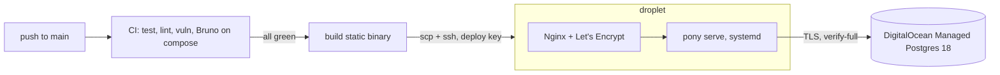

# Deploying to silson.dev



- **What runs where.**
  - The droplet runs one static Go binary under systemd, sandboxed and as an
    unprivileged `pony` user, behind Nginx.
  - Postgres is DigitalOcean's managed service: backups, upgrades and
    failover are theirs.
  - Photos are on the droplet's disk (`/var/lib/pony/photos`). Moving them to
    Spaces means writing an S3 implementation of `photo.Store`.
- **Each deploy.** Every push to `main` that passes CI is deployed. The
  `deploy` job copies the binary over, and `pony-deploy` on the droplet:
  1. keeps it as a new release;
  2. runs `pony migrate`;
  3. switches `/opt/pony/current` and restarts;
  4. waits for `/readyz`;
  5. if the new release isn't ready within 30 seconds, switches back to the
     previous release.

  CI then smoke-tests through Nginx: readiness, plus a demo login.
- **Migrations are forward-only.** A rollback restores the previous binary,
  not the schema. Migrations are written so the previous release keeps
  working: add first, remove in a later release.

## Why not Docker or Kubernetes here?

The image exists: CI builds it and runs the whole Bruno suite against it
(`make api-test`). The app already has what an orchestrator expects:

- liveness and readiness probes;
- configuration from the environment;
- graceful shutdown on SIGTERM;
- metrics on a separate port.

On a single droplet, a container would add a daemon and nothing else, and a
Go binary is already self-contained. To scale out:

1. move photos to Spaces;
2. run the same image (or binary) on N nodes behind a load balancer;
3. move the login throttle state (in-memory, per process) to Postgres or
   Redis.

The database is already shared.

## One-time set-up

1. **Database.** Create a DigitalOcean managed cluster: PostgreSQL 18,
   Standard edition, in the droplet's region, with the droplet as its only
   trusted source.
   - Create the database `dancingpony` and the user `pony_app`.
   - Download the CA certificate.
2. **Deploy key.** Run `ssh-keygen -t ed25519 -f pony_deploy -N '' -C ci-deploy`.
3. **Droplet.**
   ```sh
   scp -r deploy root@DROPLET:/root/pony-deploy-files
   ssh root@DROPLET bash /root/pony-deploy-files/bootstrap.sh "$(cat pony_deploy.pub)"
   ```
4. **Secrets on the droplet.**
   - `/etc/pony/pony.env` from `pony.env.example`, as `root:pony`, mode 0640.
   - The CA certificate as `/etc/pony/do-ca.crt`, mode 0644.
5. **Nginx.** In the `silson.dev` server block, make `location /` contain
   `include /etc/nginx/snippets/pony-proxy.conf;`. Then run
   `nginx -t && systemctl reload nginx`. The snippet proxies to the
   `pony` upstream in `/etc/nginx/conf.d/pony-upstream.conf`, which keeps
   connections to the app open. Without that, every request left a
   conntrack entry behind and at ~200 requests/s the kernel's table filled
   and dropped packets. Also raise `worker_connections` in
   `/etc/nginx/nginx.conf` from Ubuntu's 768 to 4096: at ~500 requests/s
   Nginx ran out and reset connections.
6. **GitHub secrets.** Under Settings, Environments, `production`:
   - `DEPLOY_SSH_KEY`: the private key;
   - `DEPLOY_HOST`: the droplet's IP;
   - `DEPLOY_KNOWN_HOSTS`: the output of `ssh-keyscan -t ed25519 DROPLET`.
7. **Demo data (optional).** On the droplet, run
   `sudo -u pony env $(grep MIGRATE /etc/pony/pony.env | xargs) /opt/pony/current seed`.
   The demo password is published in the repo, so this is for reviewers,
   not real users.

## Operating

| | |
|---|---|
| Logs | `journalctl -u pony -f` (JSON lines) |
| Restart | `systemctl restart pony` |
| Releases | `ls -lt /opt/pony/releases`; `/opt/pony/current` links to the live one |
| Manual rollback | `ln -sfn /opt/pony/releases/<previous> /opt/pony/current && systemctl restart pony` |
| Metrics | `curl 127.0.0.1:9091/metrics` on the droplet (never public) |
| Create an admin | `sudo -u pony env $(grep MIGRATE /etc/pony/pony.env \| xargs) /opt/pony/current admin create --email you@example.com --name "You"` |
| Rotate a database password | Reset it in the DigitalOcean panel, edit `/etc/pony/pony.env`, then `systemctl restart pony`. Do it before the next deploy, which restarts the service anyway. |

## Database access from a desktop

The database only trusts the droplet, so tunnel through it. The tunnel
lands on the droplet and goes on to the database's private VPC address.

```sh
ssh -N -L 15434:private-dancing-pony-postgres18-do-user-6189174-0.i.db.ondigitalocean.com:25060 root@DROPLET
```

Then, in another terminal:

```sh
psql "postgres://pony_app@127.0.0.1:15434/dancingpony?sslmode=verify-ca&sslrootcert=$HOME/Downloads/ca-certificate.crt"
```

- `psql` prompts for the password, so it never lands in shell history.
- Use `verify-ca`, not `verify-full`: the certificate names the database
  host, not `127.0.0.1`. The CA check still proves it's the real cluster.
- Connect as `pony_app` to see what the API sees: nothing in a tenant table
  until `SELECT set_config('app.restaurant_id', '<uuid>', false);`. Keep
  `doadmin` for schema work: on DigitalOcean it has `BYPASSRLS`, so it sees
  every tenant's rows regardless of the policies.
